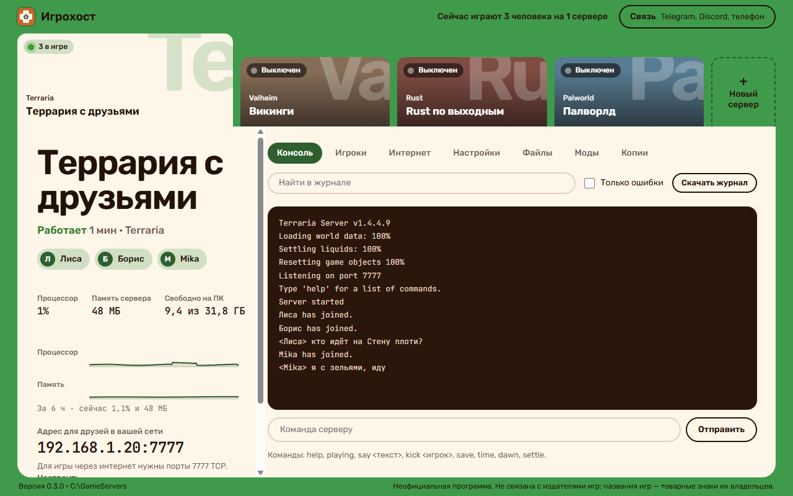
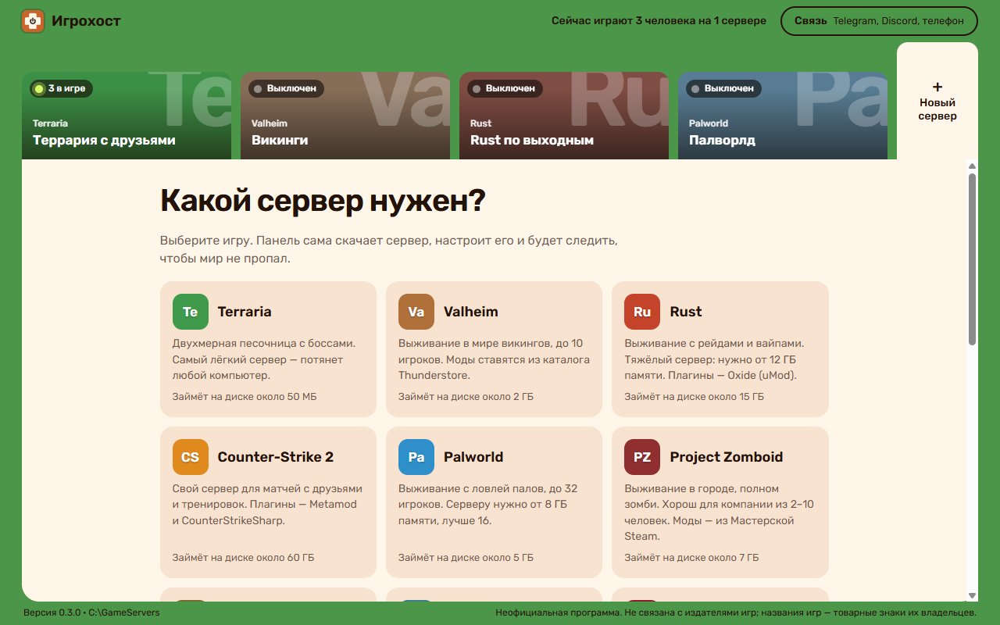
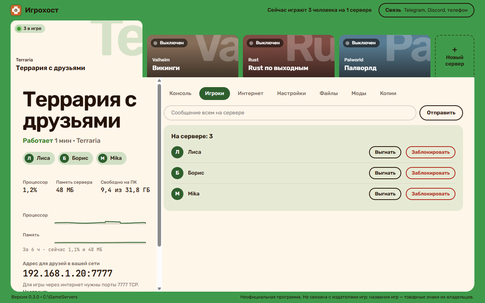
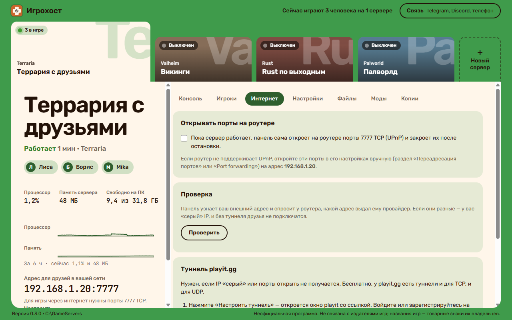
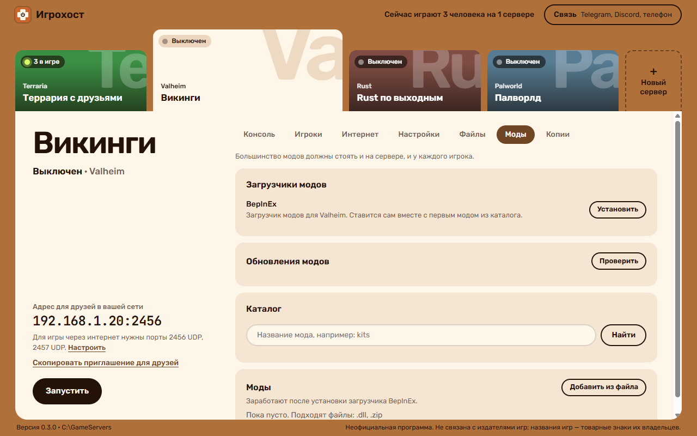

# Игрохост

Панель игровых серверов на своём компьютере: **Terraria, Valheim, Rust, Counter-Strike 2, Palworld, Project Zomboid, 7 Days to Die, Enshrouded, V Rising, Core Keeper, Team Fortress 2, Left 4 Dead 2, Garry's Mod**.
Та же идея, что у [Блокхоста](https://github.com/averagev0n/mc-server-launcher), но для разных игр: установка в один клик, моды, резервные копии, уведомления в Telegram и Discord.

<p align="center">
  <a href="https://github.com/averagev0n/igrohost/releases/latest/download/Igrohost-Setup.exe"><b>⬇ Скачать для Windows</b></a>
  &nbsp;·&nbsp;
  <a href="https://github.com/averagev0n/igrohost/releases/latest/download/Igrohost-Portable.exe">Портативная версия</a>
  &nbsp;·&nbsp;
  <a href="https://github.com/averagev0n/igrohost/releases">Что нового</a>
</p>

Windows может показать «Windows защитила ваш компьютер»: у программы пока нет платной цифровой подписи. Нажмите «Подробнее» → «Выполнить в любом случае».



<table>
  <tr>
    <td width="50%"><br><sub>Новый сервер: выберите игру — панель скачает и настроит его сама</sub></td>
    <td width="50%"><br><sub>Кто сейчас на сервере: выгнать, заблокировать, написать всем</sub></td>
  </tr>
  <tr>
    <td width="50%"><br><sub>Игра через интернет: UPnP, проверка «серого» IP, туннель playit.gg</sub></td>
    <td width="50%"><br><sub>Моды: каталог Thunderstore для Valheim, обновления одной кнопкой</sub></td>
  </tr>
</table>

## Для разработки

```bash
npm install
npm start
```

Без окна, в браузере (зависимости не нужны, достаточно Node.js 22+):

```bash
npm run web
```

Адрес с ключом доступа появится в консоли. Панель слушает только этот компьютер (127.0.0.1).
Серверы лежат в `C:\Users\<имя>\GameServers` (если в имени пользователя есть русские буквы — в `C:\GameServers`: SteamCMD не работает с такими путями).

## Что умеет

| Игра | Установка | Консоль и остановка | Моды |
|---|---|---|---|
| Terraria | архив с terraria.org | скрытая консоль Windows (сервер не читает перенаправленный ввод) | TShock и его плагины |
| Valheim | SteamCMD | журнал; остановка сигналом Ctrl+C с сохранением мира | BepInEx, каталог Thunderstore |
| Rust | SteamCMD | WebRCON | Oxide, каталог uMod |
| CS2 | SteamCMD | Source RCON | Metamod, CounterStrikeSharp, плагины из архива |
| Palworld | SteamCMD | REST API игры | UE4SS, моды .pak из файла |
| Project Zomboid | SteamCMD | обычная консоль Java | Мастерская Steam (номера и ID модов в настройках) |
| 7 Days to Die | SteamCMD | telnet, только с этого компьютера | моды-папки из архива |
| Enshrouded | SteamCMD | журнал; остановка сигналом Ctrl+C | — |
| V Rising | SteamCMD | Source RCON; остановка сигналом Ctrl+C | — |
| Core Keeper | SteamCMD | журнал; вход по коду Game ID, порты не нужны | — |
| Team Fortress 2, Left 4 Dead 2, Garry's Mod | SteamCMD | Source RCON | плагины и аддоны — через «Файлы» и папку сервера |

- **Игра через интернет**: UPnP (панель открывает порты на роутере, пока сервер работает), определение «серого» IP, туннель playit.gg.
- **Нагрузка**: процессор и память каждого сервера вместе с дочерними процессами; предупреждение, когда памяти почти не осталось.
- **Игроки**: кто онлайн, выгнать, заблокировать, назначить админом, сообщение всем — там, где у игры есть консоль.
- **Файлы**: редактор файлов настроек игры; прежняя версия сохраняется в `config-backups`.
- **Копии**: вручную, перед запуском, по расписанию, перед обновлением и восстановлением; восстановление в один клик.
- **Надёжность**: перезапуск после падения (не чаще трёх раз за десять минут) с объяснением причины, ежедневный перезапуск с предупреждением игроков, автообновление серверов игр, мягкая остановка всех серверов при выходе.
- **Уведомления и команды**: Telegram-бот (команды `/status`, `/on`, `/off`, `/restart`, `/backup`, `/cmd`, чат привязывается кодом), Discord — вебхук для уведомлений и бот с командами.
- **Работа в фоне**: закрытое окно не выключает серверы — панель у часов; запуск вместе с Windows и автозапуск серверов.
- **Миры**: перенос мира из одиночной игры (Valheim, Terraria, Core Keeper), скачивание копий, копии во вторую папку.
- **Телефон**: панель открывается в домашней сети по ПИН-коду.
- **Игрокам**: приветствие и сообщения по расписанию; сон пустого сервера (Terraria, Rust); отчёт за неделю.
- **Удобство**: график нагрузки, поиск по журналу и его скачивание, списки игроков по Steam ID, перенос готового сервера из папки, приглашение для друзей, мини-окно поверх всех окон.
- **Моды**: поиск сломанного мода делением пополам (мир на время поиска сохраняется и возвращается).
- **Обновление программы**: установленная версия обновляется сама с GitHub Releases (`averagev0n/igrohost`), портативная показывает, что вышла новая версия.

## Устройство

- `lib/games/*.js` — описание каждой игры: поля настроек, порты, запуск, что копировать, какие моды. Новая игра — новый файл.
- `lib/runner.js` — процессы серверов; `lib/rcon.js` — RCON, WebRCON, REST, telnet; `lib/steamcmd.js` — установка.
- `lib/backup.js`, `lib/mods.js`, `lib/telegram.js`, `lib/tgbot.js` — копии, моды, бот.
- `lib/app.js` — всё вместе; `lib/http.js` — веб-сервер; `renderer/` — интерфейс.
- `main.js` — окно Electron, `server.js` — запуск без окна.

```bash
npm test
```

Сборка установщика и портативной версии для Windows (появятся в папке `dist`):

```bash
npm run dist
```

Выпуск новой версии:

1. Допишите сверху в [CHANGELOG.md](CHANGELOG.md) раздел `## 0.3.0 — ГГГГ-ММ-ДД` со списком изменений.
2. Закоммитьте остальные изменения.
3. Выполните `npm run release -- 0.3.0`.

Скрипт поставит версию, прогонит тесты, соберёт установщик и портативную версию и опубликует выпуск на GitHub с описанием из CHANGELOG.md. Установленные копии увидят обновление сами.

## Отказ от ответственности

Неофициальная программа. Не связана с издателями игр; названия игр — товарные знаки их владельцев.
